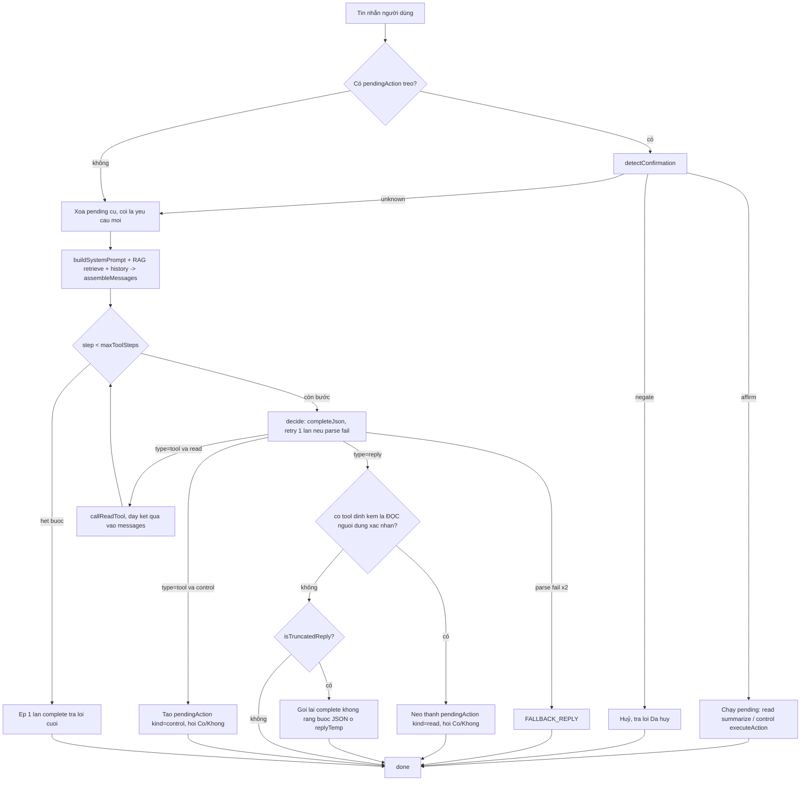
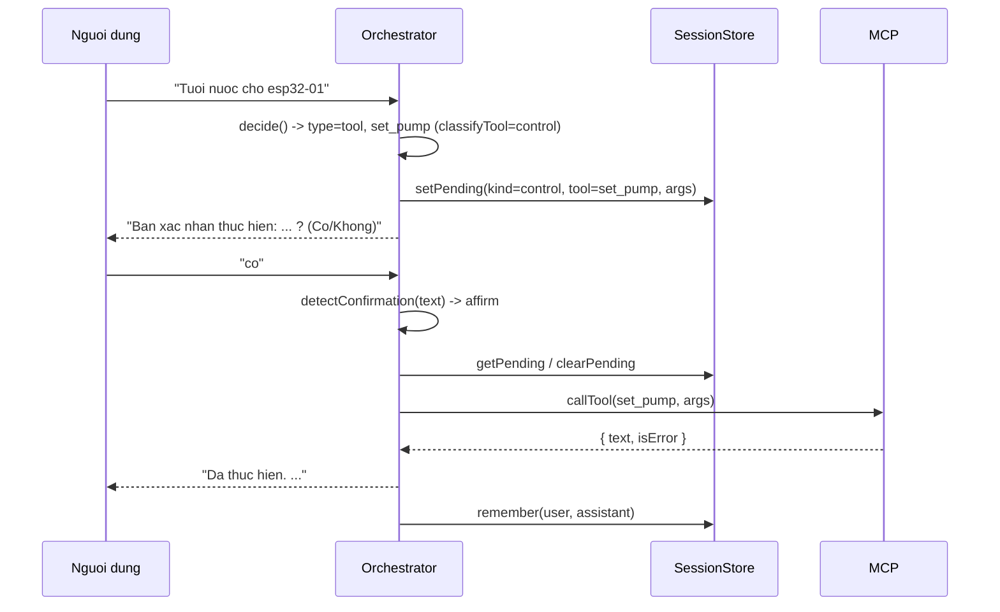

# Research: Harness cho LLM local biết gọi tools — ai-server

Phạm vi: `src/agent/*`, `src/llm/*`, `src/mcp/*`, `src/memory/*`, phần lắp ráp trong `src/setup/init.ts`,
`scripts/mcp-catalog.ts`, và các test liên quan. Mỗi mục dưới đây = 1 slide candidate.

> **Lệch so với CLAUDE.md (đã kiểm chứng):**
> 1. CLAUDE.md ghi field order là `type → message → tool → args`. Code thực tế có thêm field
>    `reasoning` đứng **TRƯỚC `type`** (thêm sau, commit `f2f405b feat(agent): lightweight CoT...`).
>    Bằng chứng: `src/agent/decision.ts:24-26` (comment "Listed FIRST...") và
>    `tests/decision.test.ts:18-21` (`lists reasoning FIRST so schema-ordered backends emit CoT before deciding`).
>    Thứ tự đúng phải là `reasoning → type → message → tool → args`.
> 2. Tiêu đề CLAUDE.md "Small-model prompt constraints (qwen2.5-3b)" phản ánh model **lúc phát hiện bug**,
>    không phải model mặc định hiện tại. `config.ts:14` / `.env.example` default đã đổi sang
>    `google/gemma-4-e4b` từ commit `85081d8 switch default LLM model to gemma-4-e4b`. Riêng
>    `tests/llm-config.test.ts:14` vẫn dùng chuỗi mẫu `'qwen2.5:3b'`. Nên nói rõ trên slide: harness
>    **model-agnostic** (mọi OpenAI-compatible server), các quy tắc prompt được **suy ngược** từ lỗi
>    quan sát trên qwen2.5-3b, không gắn cứng với model đó.

---

## Slide 1 — Tool catalog: live MCP hay static fallback?

- Nguồn catalog ưu tiên: **live MCP** (`mcp.listTools()`) khi kết nối được lúc init.
- Mất kết nối MCP → xuống cấp có kiểm soát: dùng catalog tĩnh `KNOWN_TOOLS` (mirror tay theo Python
  server) — điều khiển sẽ báo lỗi tới khi MCP lên, nhưng model vẫn "biết" tool nào tồn tại.
- `KNOWN_TOOLS` có **12 tool** cứng; comment cảnh báo "the handoff cited 13 tools" — tức catalog tĩnh
  có thể lệch/thiếu so với server thật, cần đối chiếu bằng `npm run mcp:catalog`.
- Cùng một `classifyTool()` áp cho cả 2 nguồn — an toàn không đổi dù catalog nào đang chạy.

```ts
// src/setup/init.ts:101-113
state.setStep('mcp', 'running')
let tools: McpTool[] = []
try {
  tools = await mcp.listTools()
  state.setStep('mcp', 'done', `${tools.length} tools`)
  console.log(`[mcp] connected at ${mcpUrl} — ${tools.length} tools`)
} catch (err) {
  tools = KNOWN_TOOLS
  const msg = `MCP không kết nối được (${(err as Error).message}) — dùng ${tools.length} tool tĩnh (điều khiển sẽ lỗi đến khi MCP sẵn sàng).`
  state.setStep('mcp', 'failed', msg)
  console.warn(`[mcp] ${msg}`)
}
```

**Speaker notes:** Đây là ví dụ "graceful degradation" — model không bao giờ init mà không có ý niệm
về tool nào tồn tại, kể cả khi hạ tầng IoT chưa lên. Nhấn mạnh: catalog tĩnh chỉ là *best-effort
mirror* — comment trong code tự thừa nhận có thể lệch số lượng tool so với server Python thật.

---

## Slide 2 — System prompt: render tool catalog cho model đọc

- Mỗi tool render thành 1 dòng: tên + tham số (lấy từ `inputSchema.properties`) + nhãn an toàn
  `[ĐỌC]`/`[ĐIỀU KHIỂN]` (tính lại bằng `classifyTool`) + mô tả tiếng Việt.
- Nhãn an toàn được nhúng thẳng vào catalog — model nhìn thấy ngay tool nào cần xác nhận trước khi
  nó phải tự suy luận.
- Không có tool nào → in placeholder `(chưa kết nối được tool nào)` thay vì catalog rỗng gây hiểu nhầm.

```ts
// src/llm/prompt.ts:7-18
export function renderToolCatalog(tools: McpTool[]): string {
  if (tools.length === 0) return '(chưa kết nối được tool nào)'
  return tools
    .map((t) => {
      const props = (t.inputSchema?.properties ?? {}) as Record<string, unknown>
      const params = Object.keys(props).join(', ') || 'không tham số'
      const safety = classifyTool(t.name) === 'read' ? 'ĐỌC' : 'ĐIỀU KHIỂN'
      return `- ${t.name}(${params}) [${safety}]: ${t.description ?? ''}`
    })
    .join('\n')
}
```

**Speaker notes:** Catalog không phải JSON schema thô của MCP — nó được "dịch" thành 1 dòng dễ đọc
cho model 3B, kèm nhãn an toàn ngay trong text. Đây là lý do model nhỏ vẫn phân biệt được ĐỌC vs
ĐIỀU KHIỂN dù không có cơ chế function-calling native nào ép nó.

---

## Slide 3 — Cấu trúc system prompt: thứ tự block cố định

- Thứ tự block: giới thiệu vai trò → phạm vi (chỉ dâu tây) → khoảng tối ưu số liệu (từ profile) →
  tool catalog → 12 quy tắc đánh số → few-shot (nếu có) → **quy tắc văn xuôi đặt CUỐI cùng**.
- Khoảng tối ưu (`summarizeRanges(profile)`) tính từ `deriveControlThresholds` — bơm thẳng số liệu
  domain vào prompt thay vì để model đoán ngưỡng chung của MCP.
- Toàn bộ prompt là 1 chuỗi `.join('\n')` — không có template engine, dễ trace từng dòng.

```ts
// src/llm/prompt.ts:26-36
export function buildSystemPrompt({ profile, tools, fewshot }: SystemPromptInput): string {
  const ranges = summarizeRanges(profile)
  const catalog = renderToolCatalog(tools)
  return [
    'Bạn là trợ lý AI chăm sóc cây trồng và điều khiển thiết bị IoT trong vườn.',
    `Giai đoạn hiện tại CHỈ hỗ trợ CÂY DÂU TÂY (strawberry).`,
    '',
    `Khoảng tối ưu của cây dâu: ${ranges}.`,
    '',
    'Các tool có thể dùng (ĐỌC = hệ thống tự chạy khi được yêu cầu; ĐIỀU KHIỂN = cần xác nhận người dùng trước):',
    catalog,
```

**Speaker notes:** Prompt được build lại **mỗi lượt chat** (không cache) từ `buildSystemPrompt` trong
`chatEvents` — nên đổi profile hoặc rebuild RAG có hiệu lực ngay lượt kế tiếp. Độ dài đo thực tế:
5.146 ký tự không few-shot, 7.751 ký tự có few-shot (xem mục "số liệu thật" cuối file).

---

## Slide 4 — Decision contract: schema Zod

- Mọi lượt LLM trả **đúng 1 JSON quyết định**: `type: "reply" | "tool"`.
- `reasoning` (optional): chain-of-thought ngắn, không hiển thị cho người dùng — chỉ để "làm nóng"
  model trước khi commit quyết định.
- `message` optional nhưng default `''`; `tool`/`args` optional — vì `type:"reply"` không cần chúng.
- `args` là `z.record(z.unknown())` — Zod chỉ đảm bảo đây là object, KHÔNG validate theo schema của
  từng tool (việc đó là job của `sanitizeArgs`, xem Slide "hallucinated args").

```ts
// src/agent/decision.ts:9-16
export const AgentDecisionSchema = z.object({
  /** Optional short chain-of-thought emitted BEFORE the decision; never shown to the user. */
  reasoning: z.string().optional(),
  type: z.enum(['reply', 'tool']),
  message: z.string().optional().default(''),
  tool: z.string().optional(),
  args: z.record(z.unknown()).optional().default({}),
})
```

**Speaker notes:** Đây là "hợp đồng" duy nhất giữa harness và model — không có concept `tool_calls[]`
kiểu OpenAI, không có multi-call trong 1 lượt. Đơn giản hoá tối đa để model 3B ít có cơ hội sai định
dạng.

---

## Slide 5 — JSON schema đưa cho response_format (không phải Zod schema)

- `AGENT_DECISION_JSON_SCHEMA` là JSON Schema thủ công đưa cho provider qua `response_format`, **tách
  biệt** với `AgentDecisionSchema` (Zod) — JSON schema định hướng generation, Zod validate kết quả.
- `reasoning` cố tình liệt kê **ĐẦU TIÊN** trong `properties` — với backend sinh theo đúng thứ tự
  schema (LM Studio/llama.cpp), model bị ép sinh vài token suy nghĩ trước khi chốt `type`.
- Chỉ `required: ['type']` — schema lỏng (không strict), chấp nhận model bỏ field khác.

```ts
// src/agent/decision.ts:21-33
export const AGENT_DECISION_JSON_SCHEMA: Record<string, unknown> = {
  type: 'object',
  properties: {
    // Listed FIRST so schema-ordered backends (LM Studio/llama.cpp) generate a few
    // reasoning tokens before committing to type/message — a lightweight CoT.
    reasoning: { type: 'string', description: 'Suy nghĩ ngắn 1-2 câu trước khi quyết định (không hiển thị cho người dùng)' },
    type: { type: 'string', enum: ['reply', 'tool'], description: 'reply hoặc tool' },
    message: { type: 'string', description: 'Câu trả lời tiếng Việt (reply) hoặc giải thích ngắn (tool)' },
    tool: { type: 'string', description: 'Tên tool khi type=tool' },
    args: { type: 'object', description: 'Tham số của tool khi type=tool' },
  },
  required: ['type'],
}
```

**Speaker notes:** Test `tests/decision.test.ts:18-21` khoá cứng invariant "reasoning phải đứng đầu
`properties`" — một regression ở đây sẽ âm thầm làm mất "lightweight CoT" mà không có lỗi runtime
nào báo.

---

## Slide 6 — Vì sao KHÔNG dùng native function-calling của OpenAI (điểm nhấn chính)

- **`response_format: json_schema`** (không phải `tools`/`tool_choice` của OpenAI Chat Completions)
  là cơ chế duy nhất được dùng để ép cấu trúc — cho MỌI provider (LM Studio/Ollama/Gemini-compat).
- Trên LM Studio/llama.cpp, `response_format: json_schema` được hiện thực bằng **grammar-constrained
  decoding** (GBNF) — model 3B bị ép sinh JSON hợp lệ **token-by-token**, đáng tin hơn là hy vọng nó
  tự format đúng cú pháp `tool_calls` native (một cú pháp phức tạp hơn, model nhỏ dễ lệch).
- Native function-calling chỉ trả `tool_calls[]` độc lập — không có chỗ tự nhiên để nhét thêm
  `reasoning` (CoT) hay để 1 quyết định `reply` "mang kèm" một tool ĐỌC như offer (xem Slide
  confirm-before-read). Schema tự chế cho phép gộp 2 việc này trong 1 object.
- Thứ tự field (`reasoning → type → message → tool → args`) là đòn bẩy prompt-engineering có chủ đích
  cho model 3B — thứ OpenAI's `tool_calls` schema không cho control (client không quyết được thứ tự
  bên trong 1 function call object do SDK provider tự serialize).
- `strict: false` khi gọi (xem code) — cố tình lỏng hơn "Structured Outputs" nghiêm ngặt của OpenAI,
  vì mục tiêu là tương thích rộng (LM Studio/Ollama/Gemini-compat), không chỉ OpenAI thật.
- **Lưu ý phân biệt tầng**: ở tầng HTTP `/v1/chat/completions` (facade OpenAI-compat cho client bên
  ngoài), server CÓ encode `tool_calls[]` — nhưng đó là **encode lại `pendingAction`** để client OpenAI
  echo `messages[]` round-trip, KHÔNG phải cách gọi model local bên trong. Xem
  `docs/superpowers/specs/2026-07-15-openai-compat-endpoint-design.md:149-153`.

```ts
// src/llm/index.ts:68-78
async completeJson(
  messages: ChatMessage[],
  jsonSchema: Record<string, unknown>,
  schemaName: string,
  opts?: CompleteOptions,
): Promise<string> {
  const res = await this.client.chat.completions.create({
    model: this.opts.model,
    messages,
    temperature: opts?.temperature ?? 0.1,
    response_format: {
      type: 'json_schema',
      json_schema: { name: schemaName, strict: false, schema: jsonSchema },
    },
  })
```

**Speaker notes:** Đây là slide "trade-off" quan trọng nhất bài. Không có comment nào trong code nói
thẳng "chúng tôi chọn X thay vì Y" — quyết định này nằm ở kiến trúc từ initial commit (`7b6890b`).
Bằng chứng gián tiếp mạnh nhất: (1) `docs/superpowers/plans/2026-07-05-chat-streaming-sse.md:131` xác
nhận cơ chế "JSON grammar-constrained token-by-token" trên LM Studio/llama.cpp; (2) design spec OpenAI
endpoint cho thấy `tool_calls` chỉ xuất hiện ở facade HTTP, không phải ở lệnh gọi LLM thật.

---

## Slide 7 — Agent loop: từng bước của `chatEvents` (tên thật của "runAgentLoop")

- Bước 0: nếu có `pendingAction` treo từ lượt trước → `detectConfirmation` giải quyết trước, KHÔNG
  vào loop quyết định mới.
- Bước 1: build `system` prompt + RAG retrieve + lấy `history` từ `SessionStore` → `assembleMessages`.
- Bước 2: vòng `for (let step = 0; step < maxToolSteps; step++)` — mỗi vòng gọi `decide()` (buffered)
  hoặc `decideStreaming()` (SSE).
- `type:"reply"` → thoát loop ngay (có thể kèm anchor một tool ĐỌC làm offer, hoặc sửa reply cụt).
- `type:"tool"` + `control` → tạo `pendingAction`, thoát loop, hỏi xác nhận — KHÔNG bao giờ chạy.
- `type:"tool"` + `read` → chạy thật, đẩy kết quả vào `messages` dạng `[Kết quả <tool>]`, **lặp lại**
  loop (không thoát) để model đọc kết quả và quyết định tiếp.
- Hết `maxToolSteps` mà chưa có `finalReply` → ép 1 lượt `complete()` không ràng buộc JSON để trả lời.

```ts
// src/agent/orchestrator.ts:444-457
private async decide(messages: ChatMessage[]): Promise<AgentDecision | null> {
  const opts = { temperature: this.deps.decisionTemp }
  const raw = await this.deps.llm.completeJson(messages, AGENT_DECISION_JSON_SCHEMA, AGENT_DECISION_SCHEMA_NAME, opts)
  const decision = parseDecision(raw)
  if (decision) return decision
  // one retry with a stricter nudge
  const raw2 = await this.deps.llm.completeJson(
    [...messages, { role: 'user', content: RETRY_NUDGE }],
    AGENT_DECISION_JSON_SCHEMA,
    AGENT_DECISION_SCHEMA_NAME,
    opts,
  )
  return parseDecision(raw2)
}
```

**Speaker notes:** Parse fail (JSON hỏng hoặc không khớp Zod) chỉ được retry **đúng 1 lần** với
`RETRY_NUDGE` ("Chỉ trả về đúng MỘT JSON hợp lệ theo schema..."); fail cả 2 lần → `FALLBACK_REPLY`
tĩnh, không loop vô hạn. `tests/orchestrator.test.ts` dòng "bounds read-tool loops to maxToolSteps"
khoá cứng: 4 quyết định tool liên tiếp bị chặn ở 3 lần gọi MCP, sau đó ép trả lời bằng
`llm.complete()` (1 lần).

---

## Slide 8 — Tool-safety: fail-safe default cho tool lạ

- Danh sách cứng: `READ_ONLY` (6 tool nội bộ) và `CONTROL` (6 tool điều khiển) trong
  `src/mcp/policy.ts`.
- Tool không nằm trong 2 set trên: kiểm tra `READ_PREFIXES` (`get_`, `list_`, `read_`, `fetch_`,
  `query_`) → mới coi là ĐỌC.
- Không khớp gì cả → mặc định **`control`** (fail-safe) — thà hỏi thừa còn hơn chạy nhầm lệnh chưa
  biết.

```ts
// src/mcp/policy.ts:39-44
export function classifyTool(name: string): ToolSafety {
  if (READ_ONLY.has(name)) return 'read'
  if (CONTROL.has(name)) return 'control'
  if (READ_PREFIXES.some((p) => name.startsWith(p))) return 'read'
  return 'control'
}
```

**Speaker notes:** `tests/policy.test.ts` có test tên thẳng "fails safe: unknown tool defaults to
control" — dùng `reboot_everything` làm ví dụ tool lạ để chứng minh default là `control`, trong khi
`get_future_sensor`/`list_zones` (khớp prefix) vẫn được coi là `read`.

---

## Slide 9 — Confirm-before-read: đọc cảm biến vẫn phải hỏi (UX, không phải an toàn)

- `get_latest_sensor`/`get_sensor_history` vẫn được `classifyTool` xếp là `read` (đúng bản chất) —
  nhưng khi chúng **đi kèm một quyết định `reply`** (model tư vấn + đề xuất đo), orchestrator neo
  chúng thành `pendingAction` kiểu `'read'` và hỏi (Có/Không) thay vì chạy ngay.
- Nếu người dùng hỏi **trực tiếp** số liệu ("độ ẩm đất bao nhiêu?"), model trả `type:"tool"` luôn →
  tool này chạy NGAY (đó chính là sự đồng ý của người dùng), không hỏi lại.
- Phân biệt rõ: an toàn (`classifyTool`) tách khỏi trải nghiệm xác nhận (`confirmsBeforeRead`) — 2
  tầng độc lập, tránh nhầm "đọc = luôn tự động".

```ts
// src/mcp/policy.ts:30-37
/**
 * User-facing sensor reads that are OFFERED before running. These stay `read`
 * for safety/eval purposes (see classifyTool) but the orchestrator anchors them
 * as a pending action and only runs them after the user confirms — a UX layer,
 * not a safety reclassification. Internal reads (list_devices, get_*_rule…) still
 * run automatically so the model can resolve device_id etc. mid-reasoning.
 */
const CONFIRM_BEFORE_READ = new Set<string>(['get_latest_sensor', 'get_sensor_history'])
```

**Speaker notes:** `tests/orchestrator.test.ts` có bộ test riêng "user-facing sensor reads (run
direct, offer on reply)" — verify cả 2 nhánh: hỏi trực tiếp thì chạy ngay, hỏi tư vấn thì chỉ offer.
`tests/policy.test.ts` cũng khoá: `confirmsBeforeRead` không đổi kết quả của `classifyTool`/`isReadOnly`.

---

## Slide 10 — Xác nhận bằng free-text tiếng Việt "có/không"

- `detectConfirmation` dùng 2 regex neo ở đầu chuỗi (`^...`) với boundary lookahead
  `(?=$|[\s,.!?;:])` — bắt "có" nhưng không bắt nhầm "cỏ" hay từ khác bắt đầu giống.
- AFFIRM bắt: `có, ừ, ừm, okie, ok, đồng ý, xác nhận, đúng rồi, đúng, chắc chắn, chắc, tiến hành,
  thực hiện, làm đi, yes`.
- NEGATE bắt: `không, khong, hủy, huỷ, đừng, thôi, khoan, dừng, no`.
- Không khớp cả 2 → `'unknown'` → orchestrator **xoá pendingAction cũ** và coi tin nhắn là yêu cầu
  MỚI (an toàn: không âm thầm thực thi khi ý định không rõ).

```ts
// src/agent/confirmation.ts:44-56
const BOUNDARY = '(?=$|[\\s,.!?;:])'
const AFFIRM = new RegExp(
  `^(có|ừ|ừm|okie|ok|đồng ý|xác nhận|đúng rồi|đúng|chắc chắn|chắc|tiến hành|thực hiện|làm đi|yes)${BOUNDARY}`,
  'i',
)
const NEGATE = new RegExp(`^(không|khong|hủy|huỷ|đừng|thôi|khoan|dừng|no)${BOUNDARY}`, 'i')

/** Fallback detection of yes/no when the chat app sends confirmation as free text. */
export function detectConfirmation(text: string): ConfirmIntent {
  const t = text.trim().toLowerCase()
  if (AFFIRM.test(t)) return 'affirm'
  if (NEGATE.test(t)) return 'negate'
  return 'unknown'
}
```

**Speaker notes:** `pendingAction` có TTL 30 phút (`PENDING_TTL_MS`, `src/memory/sessions.ts:64`) —
quá hạn thì `getPending` tự coi như không có, tránh việc người dùng gõ "có" sau nhiều giờ mà hệ thống
vẫn thực thi một lệnh cũ không còn liên quan.

---

## Slide 11 — Streaming: chỉ `message` lên wire, `reasoning`/tool không bao giờ leak

- `JsonStringFieldStreamer` là 1 state machine tự viết (không dùng JSON streaming parser có sẵn) scan
  từng ký tự của delta thô, track stack độ sâu object/array + trạng thái trong-chuỗi (escape, hex
  unicode) để biết đang ở field top-level nào.
- Chỉ bắt sự kiện cho field top-level: `message` (nội dung) và `type`/`tool` (giá trị hoàn chỉnh) —
  `reasoning`, `args`, hay `message` lồng trong `args` (model có thể hallucinate) đều bị bỏ qua.
- Orchestrator dùng cơ chế **gate 3 trạng thái** (`pending → open/closed`): giữ (`held`) text của
  `message` cho tới khi biết `type`. Nếu `type==="reply"` → mở gate, xả hết phần đã giữ rồi stream
  tiếp trực tiếp; nếu không → đóng gate vĩnh viễn cho lượt đó (không lộ ra ngoài).
- Nếu 2 lần thử `decideStreaming` đều parse fail: phần đã lỡ emit bị "undo" bằng event `reset` trước
  khi thử lại hoặc rơi vào fallback.

```ts
// src/agent/orchestrator.ts:498-512 (trong streamDecisionAttempt)
for await (const delta of stream) {
  for (const event of scanner.push(delta)) {
    if (event.kind === 'message') {
      if (gate === 'open') {
        emittedText += event.text
        yield { type: 'token', text: event.text }
      } else if (gate === 'pending') {
        held += event.text
      }
    } else if (event.kind === 'field' && event.key === 'type' && gate === 'pending') {
      if (event.value === 'reply') {
        gate = 'open'
        if (held) {
          emittedText += held
          yield { type: 'token', text: held }
```

**Speaker notes:** `src/agent/streamParser.test.ts` (11 test) fuzz mọi điểm cắt chunk có thể của 1
chuỗi JSON mẫu để đảm bảo `message` decode ra **y hệt** kết quả `JSON.parse` thật — kể cả escape cắt
giữa `\uXXXX`, cặp surrogate emoji 🍓 bị cắt ngang, và field `message` giả nằm trong `args` (decoy)
không được lẫn vào.

---

## Slide 12 — 3B trick #1: quy tắc "văn xuôi, không liệt kê" đặt CUỐI prompt (recency)

- Model 3B viết đoạn văn tự nhiên trong JSON string tốt, nhưng khi định viết danh sách bên trong
  chuỗi JSON, nó viết câu dẫn kết thúc bằng dấu `:` rồi **đóng JSON luôn** — danh sách không bao giờ
  xuất hiện. `finish_reason=stop` (model tự dừng), KHÔNG phải bị cắt do hết token.
- Quy tắc "viết văn xuôi 2-5 câu, không gạch đầu dòng, không kết thúc bằng dấu hai chấm" được đặt Ở
  DÒNG CUỐI CÙNG của system prompt — comment trong code nói rõ: đặt giữa prompt bị model bỏ qua, đặt
  cuối (gần vị trí sinh token nhất) mới có tác dụng.
- `isTruncatedReply` là **lưới an toàn cấu trúc** bổ sung: dù prompt có bị model phớt lờ, code vẫn
  phát hiện reply rỗng/kết thúc bằng `:`/`：` và regenerate bằng 1 lệnh gọi văn xuôi không ràng buộc
  JSON (ở `replyTemp`), thay vì đẩy fragment cho người dùng.

```ts
// src/llm/prompt.ts:58-64
fewshot ? `\nVÍ DỤ:\n${fewshot}` : '',
// Đặt CUỐI cùng (gần vị trí sinh token nhất) vì model nhỏ hay bỏ qua quy tắc ở
// giữa prompt. Model 3B viết đoạn văn trong JSON tốt nhưng hay "hụt" khi định
// liệt kê trong chuỗi JSON: viết câu dẫn kết thúc bằng ":" rồi đóng JSON, danh
// sách không bao giờ xuất hiện (reply cụt/đứt đoạn). Ép trả lời bằng văn xuôi.
'\nQUAN TRỌNG khi type="reply": viết "message" thành ĐOẠN VĂN liền mạch 2-5 câu, KHÔNG dùng gạch đầu dòng hay danh sách đánh số, và KHÔNG kết thúc "message" bằng dấu hai chấm ":". Nói thẳng nội dung, không hứa "dưới đây là..." rồi bỏ dở.',
].join('\n')
```

Bổ trợ — hàm phát hiện reply cụt (lưới an toàn, không phụ thuộc model có nghe lời hay không):

```ts
// src/agent/orchestrator.ts:80-84
export function isTruncatedReply(message: string): boolean {
  const t = message.trim()
  if (t === '') return true
  return t.endsWith(':') || t.endsWith('：')
}
```

**Speaker notes:** `tests/prompt.test.ts:21-24` khoá đúng thứ tự: `system.indexOf('VÍ_DỤ_MẪU')` phải
NHỎ HƠN `system.indexOf('ĐOẠN VĂN')` — tức few-shot phải đứng TRƯỚC quy tắc văn xuôi, không phải
ngược lại. Đây là bài học "recency bias" cụ thể đo được trên model 3B, không phải lý thuyết suông.

---

## Slide 13 — 3B trick #2: field order `message` PHẢI đứng trước `tool`/`args`

- Model 3B có xu hướng **đóng JSON ngay sau `args`** khi trả `type:"tool"` — nếu few-shot dạy nó viết
  `message` SAU `tool`/`args`, field `message` gần như không bao giờ được sinh ra (tool decision
  không có lời dẫn giải thích mục đích).
- Đảo thứ tự trong few-shot thành `message` TRƯỚC `tool`/`args` → đo được **~11/12** tool-decision có
  lời dẫn đúng mục đích + tác động dự kiến (số liệu ghi trong comment, không phải ước lượng của tôi).
- Quy tắc áp cho CẢ few-shot LẪN dòng mô tả schema trong system prompt (rule số 2) — đồng bộ 2 nơi
  để không có tín hiệu trái chiều.

```ts
// src/domain/fewshot.ts:4-10 (đầu file)
* FIELD ORDER MATTERS for type="tool": put "message" BEFORE "tool"/"args". The
* 3B closes the JSON right after "args", so a "message" placed after "args" is
* almost never emitted (tool decisions came back with no lead-in). With
* message-first, ~11/12 tool decisions carry the intended purpose+effect
* lead-in. Do NOT reorder these back to message-last.
*/
const FEWSHOT = `
```

**Speaker notes:** `tests/prompt.test.ts:40-48` ("puts message before tool in every type=tool
few-shot example") vừa assert few-shot **có** pattern `"type":"tool","message"`, vừa assert nó
**KHÔNG** chứa `"type":"tool","tool"` (tức không còn ví dụ message-last sót lại) — test 2 chiều để
chặn cả regression thêm mới lẫn quên xoá ví dụ cũ.

---

## Slide 14 (bonus) — Sanitize args: chặn tham số model bịa trước khi tới MCP

- Model 3B hay hallucinate thêm field (vd nhét `message` của decision vào `args`, hoặc thêm
  `duration` cho lệnh không cần) — nếu forward thẳng, MCP nghiêm ngặt có thể từ chối cả request.
- `sanitizeArgs` chỉ giữ lại key có trong `tool.inputSchema.properties`; tool lạ / schema không rõ →
  fail-safe giữ nguyên args (không đoán).

```ts
// src/mcp/args.ts:17-26
export function sanitizeArgs(tool: McpTool | undefined, args: Record<string, unknown>): Record<string, unknown> {
  const props = tool?.inputSchema?.properties
  if (!props || typeof props !== 'object') return { ...args }
  const allowed = new Set(Object.keys(props))
  const out: Record<string, unknown> = {}
  for (const [key, value] of Object.entries(args)) {
    if (allowed.has(key)) out[key] = value
  }
  return out
}
```

**Speaker notes:** Đây là lớp an toàn thứ 3 song song với `classifyTool` (an toàn hành động) và
`isTruncatedReply` (an toàn nội dung) — cho thấy triết lý chung của codebase: model 3B KHÔNG được tin
tưởng tuyệt đối ở bất kỳ tầng nào, luôn có structural net phía sau prompt engineering.

---

## Sơ đồ 1 — Agent loop (mermaid flowchart)



## Sơ đồ 2 — Confirm flow (mermaid sequence)



---

## Số liệu thật (dùng làm điểm nhấn slide)

| Số liệu | Giá trị | Nguồn |
|---|---|---|
| `MAX_TOOL_STEPS` mặc định | **3** | `src/config.ts:31`, `.env.example` |
| Số tool trong `KNOWN_TOOLS` (static fallback) | **12** | `src/mcp/knownTools.ts:23-36` |
| Số tool live MCP theo handoff cũ (so sánh) | **13** (comment cảnh báo có thể lệch) | `src/mcp/knownTools.ts:10-11` |
| `READ_ONLY` set | **6 tool** | `src/mcp/policy.ts:10-17` |
| `CONTROL` set | **6 tool** | `src/mcp/policy.ts:19-26` |
| `CONFIRM_BEFORE_READ` set | **2 tool** (`get_latest_sensor`, `get_sensor_history`) | `src/mcp/policy.ts:37` |
| `READ_PREFIXES` | **5 pattern** (`get_`, `list_`, `read_`, `fetch_`, `query_`) | `src/mcp/policy.ts:28` |
| Độ dài system prompt (KNOWN_TOOLS, không few-shot) | **5.146 ký tự** | đo bằng `buildSystemPrompt` runtime |
| Độ dài system prompt (có few-shot) | **7.751 ký tự** (≈ 1.900-2.000 token ước lượng thô, chars/4) | đo runtime |
| Độ dài riêng few-shot | **2.597 ký tự**, 6 ví dụ | `src/domain/fewshot.ts` |
| `decisionTemp` mặc định | **0.1** | `src/config.ts:37` |
| `replyTemp` mặc định | **0.3** | `src/config.ts:38` |
| Số lần retry khi parse decision fail | **1 lần nudge** (2 lần gọi `completeJson` tổng cộng) rồi fallback | `src/agent/orchestrator.ts:444-457` |
| `PENDING_TTL_MS` mặc định | **1.800.000 ms = 30 phút** | `src/memory/sessions.ts:64`, `.env.example` |
| `maxTurns` mặc định SessionStore | **20 turn** (= 40 message) | `src/memory/sessions.ts:63` |
| Tổng số test toàn repo | **263 tests / 36 test file** (đo bằng `npx vitest run`, xanh 100%) | runtime |
| Test riêng cho decision schema | **4 test** | `tests/decision.test.ts` |
| Test riêng cho system prompt (recency, field order) | **4 test** | `tests/prompt.test.ts` |
| Test riêng cho tool policy | **6 test** | `tests/policy.test.ts` |
| Test riêng cho confirmation | **11 test** | `tests/confirmation.test.ts` |
| Test riêng cho streaming JSON scanner | **11 test** | `src/agent/streamParser.test.ts` |
| Test riêng cho orchestrator (buffered) | **34 test** | `tests/orchestrator.test.ts` |
| Test riêng cho orchestrator (streaming) | **16 test** | `tests/orchestrator.stream.test.ts` |

---

## Ghi chú nguồn cho phần "vì sao không dùng native function-calling"

Không có commit/comment nào nói thẳng 1 câu "chúng tôi cân nhắc native function-calling và bỏ vì X" —
đây là suy luận có căn cứ từ:

1. `src/llm/index.ts:68-78` — mọi lệnh gọi quyết định đều qua `response_format: json_schema`, không
   bao giờ dùng `tools`/`tool_choice` của OpenAI Chat Completions API.
2. `docs/superpowers/plans/2026-07-05-chat-streaming-sse.md:131` — xác nhận rõ ràng cơ chế thật đằng
   sau: *"LM Studio/llama.cpp stream JSON grammar-constrained token-by-token bình thường"* — tức
   response_format json_schema trên các server này là **grammar-constrained decoding**, không phải
   model tự nguyện tuân thủ.
3. `docs/superpowers/specs/2026-07-15-openai-compat-endpoint-design.md:149-153` — làm rõ `tool_calls`
   CÓ xuất hiện, nhưng chỉ ở facade `/v1/chat/completions` để client OpenAI ngoài echo lại
   `messages[]`; đây là encode của `pendingAction` sau khi orchestrator đã quyết định xong, không phải
   input cho model local.
4. Từ initial commit (`7b6890b`, 2026-07-01) `decision.ts` đã tồn tại với thiết kế JSON-schema-tự-chế
   này — không có lịch sử "migrate từ function-calling sang json_schema" để trace, đây là quyết định
   kiến trúc từ đầu dự án.
